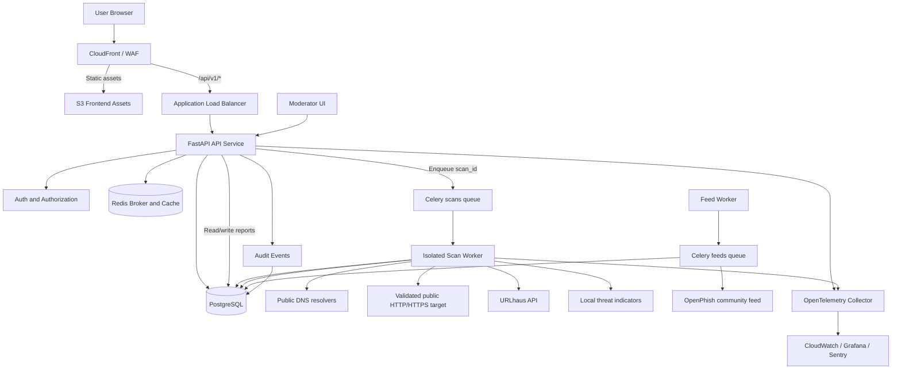
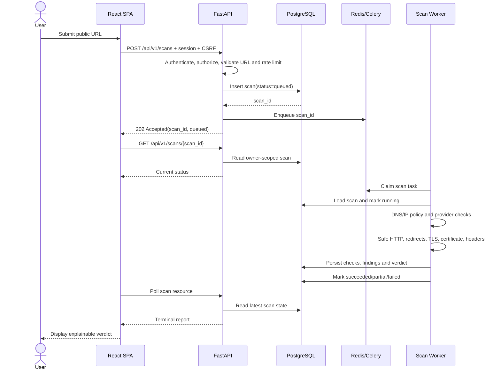
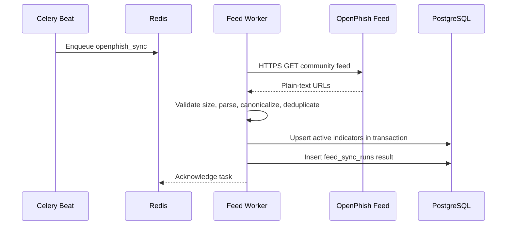
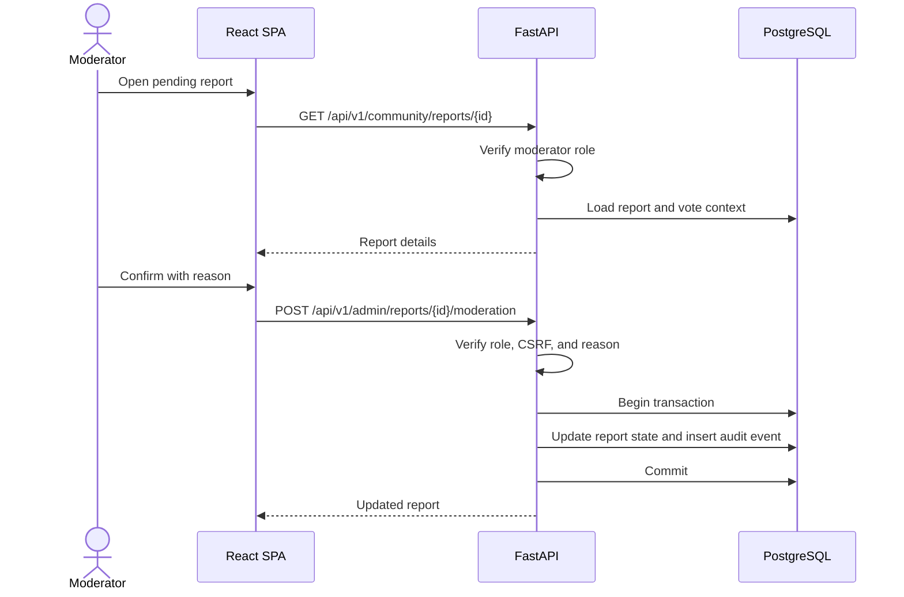

# TrustLens — Architecture and Technical Design

**Document version:** 1.0  
**Architecture style:** Modular monolith API + isolated asynchronous scanner workers  
**Primary language:** Python 3.12  
**Frontend:** React + TypeScript  
**Database:** PostgreSQL 18  
**Queue/cache:** Redis 7.4 + Celery 5  
**Deployment target:** AWS ECS Fargate, RDS PostgreSQL, ElastiCache Redis, CloudFront/S3  

## 1. Architecture decisions

TrustLens uses a Python-first modular monolith for the API and domain logic, with scanning and feed ingestion isolated into background worker processes. This fits the product's security-sensitive network workload while keeping development and deployment manageable for a small team. The frontend is a separate TypeScript SPA. PostgreSQL is the source of truth; Redis is only a transient queue/cache and must never be the sole store of scan or user data.

The scanner is a separate trust boundary. It receives only a validated `scan_id`, loads the persisted target from PostgreSQL, applies the target policy again, and performs tightly bounded network access. The public API process does not fetch user-provided URLs. The worker does not have access to arbitrary private network destinations, cloud metadata, or administrative service ports.

### 1.1 Architectural constraints

- One public API origin serves the SPA and `/api/v1`; production uses same-site routing to simplify cookie security and avoid permissive CORS.
- API and worker services share domain models and database migrations but have different network permissions.
- All target network traffic originates from the scanner task role/subnet and is subject to egress controls.
- All target redirects are followed manually, one hop at a time, after fresh validation.
- Every scan is persisted before the task is queued.
- Every scan report is immutable after completion except for administrative data corrections that create an audit record and a new scoring version; the MVP does not silently rewrite old verdicts.
- Provider adapters normalize external responses to TrustLens's internal provider-check contract.
- Rule-based scoring is deterministic and versioned; no LLM is allowed to decide the verdict.

## 2. Technology stack matrix

Versions below define compatibility baselines. Exact patch versions must be resolved and committed in `uv.lock`, `package-lock.json`, container image digests, and Terraform provider locks. Production must not use floating `latest` image tags.

| Layer | Technology | Version baseline | Responsibility / reason |
|---|---|---|---|
| Backend runtime | Python | 3.12.x | Main backend language; established async/network ecosystem and strong typing support |
| API framework | FastAPI | 0.115+ | Typed REST API, dependency injection, OpenAPI generation, request validation |
| ASGI server | Uvicorn | 0.30+ | Runs FastAPI behind the production load balancer |
| Schema validation | Pydantic | 2.x | Validates request/response DTOs and environment settings |
| Settings | pydantic-settings | 2.x | Typed environment configuration and secret references |
| ORM | SQLAlchemy | 2.x | Explicit data access and transaction boundaries |
| Database driver | psycopg | 3.x | PostgreSQL driver shared by API and workers |
| Migrations | Alembic | 1.x | Versioned database schema upgrades and downgrade paths |
| API provider HTTP | httpx | 0.27+ | Outbound calls to URLhaus and feed metadata endpoints; fixed allowlisted provider hosts only |
| Target HTTP scanner | aiohttp | 3.10+ | Async bounded HTTP fetching with a custom validating DNS resolver, manual redirects, strict timeouts, and original-host SNI |
| DNS | dnspython | 2.6+ | A/AAAA resolution and explicit address-policy inspection |
| Certificate parsing | cryptography | 43+ | Parse the leaf X.509 certificate and extract certificate metadata |
| TLS client | Python `ssl` / OpenSSL | OpenSSL 3.x runtime | Trust-store validation, SNI, hostname checking, negotiated protocol and cipher |
| URL canonicalization | Python `urllib.parse` + `idna` | Standard library + 3.x | Strict HTTP(S) parsing, IDNA hostname normalization; never use permissive string matching for host checks |
| Password hashing | argon2-cffi | 23+ | Argon2id password hash generation and verification |
| Email validation | email-validator | 2.x | Registration email syntax validation |
| Queue | Celery | 5.x | Durable task orchestration with retries and separate worker queues |
| Queue broker/cache | Redis | 7.4+ | Celery broker, short-lived rate-limit counters, and cache; not authoritative data storage |
| Frontend runtime | Node.js | 22 LTS | Reproducible frontend toolchain |
| Frontend library | React | 19.x | Component-based single-page application |
| Language | TypeScript | 5.x, strict mode | Typed API contracts and UI state |
| Bundler/dev server | Vite | 6+ | Fast local development and production asset build |
| Routing | React Router | 7.x | Client-side routes and protected-page layout |
| Server state | TanStack Query | 5.x | Fetching, caching, invalidation, polling scan status |
| Form state | React Hook Form | 7.x | Accessible forms with minimal rerenders |
| Form validation | Zod | 3.x | Client-side request validation aligned with API DTOs |
| Styling | Tailwind CSS | 4.x | Utility-first responsive styling and design-token integration |
| UI primitives | Radix UI | Current stable compatible release | Accessible dialog, dropdown, tabs, tooltip, and popover primitives |
| Icons | lucide-react | Current stable compatible release | Consistent line icons |
| Charts | Recharts | 2.x+ | Dashboard verdict-distribution and scan-history charts |
| API client | OpenAPI-generated TypeScript client | Generated from FastAPI OpenAPI | Prevents frontend/backend contract drift |
| Unit testing backend | pytest, pytest-cov | 8.x | Unit and coverage tests |
| Async test support | pytest-asyncio | 0.24+ | Async scanner/provider unit tests |
| HTTP mocking | respx | 0.21+ | Deterministic tests for URLhaus/OpenPhish metadata HTTP calls |
| DB integration tests | testcontainers-python | 4.x | Real PostgreSQL integration tests in CI |
| Frontend testing | Vitest, Testing Library, MSW | Current stable compatible versions | Component tests and API mocking |
| Browser E2E | Playwright | 1.x | End-to-end user journeys; only tests TrustLens itself, never target-site scanning |
| Lint/format | Ruff, mypy, ESLint, Prettier | Current stable compatible releases | Consistent code style and static checks |
| Containers | Docker, Docker Compose | Current supported releases | Repeatable local and production packaging |
| Orchestration | AWS ECS Fargate | Managed | Runs API and isolated workers without managing Kubernetes control planes |
| Database hosting | Amazon RDS for PostgreSQL | PostgreSQL 18 compatible | Managed backups, maintenance, and point-in-time recovery |
| Cache hosting | Amazon ElastiCache for Redis | Redis-compatible 7.x+ | Managed Celery broker and cache |
| Static frontend | S3 + CloudFront | Managed AWS | Serves immutable SPA assets at the same public origin via edge routing |
| Edge security | AWS WAF + ALB | Managed AWS | Rate controls, TLS termination, request-size limits, and routing |
| Secrets | AWS Secrets Manager | Managed AWS | Database, Redis, URLhaus Auth-Key, and signing secrets |
| IaC | Terraform | 1.x | Repeatable network, IAM, ECS, RDS, Redis, WAF, and monitoring resources |
| Observability | OpenTelemetry + CloudWatch; Prometheus/Grafana optional | Current stable | Traces, metrics, dashboards, and alerting |
| Error monitoring | Sentry | Current stable SDK | Frontend/backend exception reporting with PII scrubbing |
| CI/CD | GitHub Actions | Hosted | Lint, tests, security checks, image build, and staged deploy |

### 2.1 Why these choices

- **Python backend:** The scan pipeline relies on DNS, HTTP, TLS, X.509 parsing, threat-feed ingestion, and deterministic rules. Python has a mature ecosystem for each. It also matches a Python/ML-oriented development workflow without making the MVP depend on machine learning.
- **FastAPI + Pydantic:** Gives typed boundaries and a generated OpenAPI contract, which an agentic development workflow can use to generate a frontend client.
- **PostgreSQL:** Stores relational ownership, scan state, findings, votes, and audit records with transactions and indexes. JSONB is used only for variable evidence payloads, not for core relational identity.
- **Celery + Redis:** Separates user-facing request latency from potentially slow network checks. Multiple queues prevent feed refresh work from delaying scans.
- **Dedicated scanner network identity:** Makes SSRF mitigation a system property rather than relying on input validation alone.
- **React + TypeScript:** Provides an accessible, responsive dashboard and strongly typed API integration.
- **ECS Fargate:** Reduces infrastructure overhead while allowing API and scanner workers to use separate task roles and security groups.

## 3. Logical system architecture



## 4. Runtime services and trust boundaries

### 4.1 Frontend delivery

- Build the SPA as static assets.
- Store hashed build output in S3; serve via CloudFront.
- Route `/api/v1/*` from CloudFront to the ALB/API origin.
- Configure one canonical HTTPS application origin, such as `https://app.trustlens.example`; the example hostname is deployment configuration, not a hard-coded product dependency.
- Do not put provider secrets in frontend environment variables. Only non-secret API base configuration is allowed.
- Apply CSP to the SPA, including `default-src 'self'`, `object-src 'none'`, `base-uri 'self'`, `frame-ancestors 'none'`, and narrowly allowlisted script/style/font/image sources required by the build.

### 4.2 API service

The API handles authentication, authorization, input validation, CRUD operations, rate limits, task enqueueing, and report serialization. It must not make a target URL network request synchronously.

API request lifecycle:

1. ALB/WAF enforces TLS, request-size, and coarse IP rate controls.
2. FastAPI attaches a `request_id` and validates headers/body.
3. Authentication middleware hashes the session cookie and loads the active session/user.
4. State-changing routes verify the CSRF header and exact `Origin`.
5. Route handler authorizes ownership/role before reading or mutating private data.
6. Pydantic DTO validates inputs; domain service applies product rules.
7. For scans, API sets `scans.is_sensitive` when request field `treat_as_sensitive` is true or the automatic secret-pattern detector flags the URL. This flag is persisted with the scan and is authoritative for the worker privacy policy.
8. SQLAlchemy transaction persists the state change.
9. For scans, API adds a Celery task to Redis after database persistence. If task enqueue fails, it marks the scan failed and emits an error.
10. API serializes the stable response contract and returns.

### 4.3 Scan worker

The scan worker has the strongest network restrictions in the platform.

- It consumes only `scan_id` task arguments; it never trusts a URL embedded in a queue message.
- It reloads the scan and canonical URL from PostgreSQL and confirms `status == queued`.
- It marks the scan `running` in a transaction and records `started_at`.
- It invokes independent services: `ThreatIntelService`, `SafeHttpFetcher`, `CertificateInspector`, `WebSecurityAnalyzer`, `CommunityIntelService`, and `RiskScorer`.
- If `scans.is_sensitive` is true, as derived from `treat_as_sensitive` or automatic secret-pattern detection, `ThreatIntelService` must not transmit the full URL to an external lookup API. It may perform exact local lookups against the already-ingested OpenPhish feed and moderator-confirmed community indicators. It skips the URLhaus per-URL request and persists URLhaus `provider_checks.result_status=skipped_sensitive_url`; this is not `no_match` and prevents a `SAFE` verdict.
- It writes provider checks, redirect hops, certificate facts, findings, risk score, verdict, scoring version, and completion timestamp.
- If one sub-check fails, the worker records a structured failure and continues where safe. If a decisive threat match exists, later optional failures do not erase the malicious verdict.
- It changes `status` to `succeeded` or `partial`; unrecoverable internal errors set `failed` and `verdict=INCONCLUSIVE`.
- It acknowledges the Celery task only after database commit.

### 4.4 Feed worker

- The feed worker runs a scheduled refresh for OpenPhish community data every 12 hours, respecting the provider's published community-feed cadence and terms. This creates a local cache so URL matching does not need to transmit every submitted URL to OpenPhish.
- It downloads the feed over HTTPS using a fixed provider host allowlist, validates content shape and maximum size, and parses one URL per line.
- It canonicalizes each URL through the same URL-normalization module used by scan creation.
- It upserts `threat_indicators` with source `openphish`, indicator type `url`, and provider timestamps where provided; because the community text feed may not include per-record timestamps, `last_seen` is the ingestion time.
- It marks records absent from a new feed inactive only after a successful complete feed download and parse. A failed or partial feed must not deactivate prior indicators.
- It records the run in `feed_sync_runs` and publishes provider freshness metrics.
- URLhaus is queried per submitted URL through its URL lookup endpoint; a local URLhaus bulk feed import is not required for MVP.

### 4.5 Database and cache

**PostgreSQL is authoritative** for users, sessions, scans, findings, redirects, certificates, provider checks, community reports, votes, indicators, feed sync runs, and audit events.

**Redis is ephemeral** for Celery messages, rate-limit counters, and short-lived response caches. A Redis flush must not delete a user, scan, report, or finding. Celery tasks should carry only identifiers, not complete user records or secrets.

### 4.6 Moderator interface

Moderator pages are normal frontend routes protected by backend role checks. Hiding a button is not authorization. The API validates `moderator` or `admin` role on every moderation request. The report status and audit row are committed in one PostgreSQL transaction.

## 5. Scanner safety and network policy

### 5.1 URL intake policy

The shared `url_policy` module accepts only absolute `http://` and `https://` URLs. It rejects user-info, IP-literal hostnames, unsupported ports, malformed IDNA names, invalid host labels, and URLs longer than 2,048 bytes. It canonicalizes the hostname to lower-case IDNA ASCII, removes default ports and fragments, and preserves the path and query string.

### 5.2 DNS validation and connection pinning

1. Resolve both A and AAAA records through the configured DNS resolver.
2. Reject the target if resolution fails or if any returned address is not globally routable.
3. Explicitly reject loopback, private, link-local, carrier-grade NAT, multicast, unspecified, reserved, documentation, benchmarking, IPv4-mapped IPv6, IPv6 unique-local, IPv6 link-local, and cloud metadata ranges.
4. Return the validated addresses through a custom `aiohttp.abc.AbstractResolver` implementation.
5. Disable the connector DNS cache (`ttl_dns_cache=0`) and resolve again for each new connection.
6. The connector connects only to an address returned by the validating resolver while preserving the original hostname for HTTP `Host`, TLS SNI, and certificate hostname validation.
7. Do not use automatic redirects. Every `Location` is parsed and revalidated from step 1 before the next connection.
8. Enforce an infrastructure egress deny rule for internal/private ranges and metadata services as a second layer.

A domain allowlist alone is not sufficient. The DNS validation and the actual destination connection must use the same validated resolution to prevent DNS rebinding between check and connect.

### 5.3 HTTP request profile

- Methods: `GET` only.
- Redirects: manual, maximum 5 hops.
- Allowed destination ports: 80 and 443 only.
- User-Agent: `TrustLens-Scanner/1.0 (+https://trustlens.example/scanner)`; production domain is configured at deployment.
- No cookies, authorization header, referer, user-provided headers, or browser session.
- Timeout: 3 seconds connect, 5 seconds read per hop, 10 seconds absolute scan fetch budget.
- Body: read at most 128 KiB; abort further reading once the cap is reached.
- No JavaScript, HTML rendering, active content execution, forms, downloads, file parsing, WebSockets, or subresource crawling.
- No use of proxy environment variables (`trust_env=False`).

### 5.4 Egress network controls

Scanner tasks use a dedicated security group and subnet. Egress is allowed only to configured public DNS resolvers, TCP 80/443 public destinations, and the exact provider endpoints required for threat intelligence. Egress to RFC1918, loopback, link-local, VPC CIDRs, container control plane, database admin ports, Redis, and cloud metadata addresses is denied. Database access is an explicit private dependency with a narrow security-group rule; the scanner cannot route to database management interfaces.

## 6. Domain module boundaries

| Module | Owns | Must not own |
|---|---|---|
| `auth` | Registration, password hashes, sessions, role checks, CSRF | Scan logic, provider calls |
| `users` | User profile and account status | Password raw values |
| `scans` | Scan lifecycle, ownership, task orchestration, scan query | Raw HTTP fetching or provider-specific parsing |
| `url_policy` | URL parsing, canonicalization, hostname and IP policy | Persistence or scoring |
| `scanner` | Safe HTTP fetch, redirects, DNS validation | User authentication, report moderation |
| `certificates` | TLS handshake verification, X.509 extraction | Verdict policy |
| `web_security` | Header/cookie/TLS finding rules | Network connection management |
| `threat_intel` | Provider interfaces, local indicators, provider checks | User-facing report rendering |
| `community` | Community reports, votes, moderation transitions | Direct worker network access |
| `risk` | Versioned deterministic scoring and verdict assignment | HTTP requests, database session ownership |
| `dashboard` | User-scoped aggregations | Cross-user private data |
| `audit` | Immutable moderation/admin event persistence | UI-specific presentation |

## 7. Production repository blueprint

The following is the intended repository structure. Files marked as configuration or operational artifacts are part of the build, not optional stubs.

```text
trustlens/
├── README.md
├── LICENSE
├── SECURITY.md
├── CONTRIBUTING.md
├── .gitignore
├── .dockerignore
├── .editorconfig
├── .env.example
├── Makefile
├── compose.yaml
├── compose.test.yaml
├── pyproject.toml
├── uv.lock
├── package.json
├── package-lock.json
├── tsconfig.base.json
├── openapi/
│   └── trustlens-v1.json
├── docs/
│   ├── PRD.md
│   ├── ARCH.md
│   ├── API.md
│   ├── UI.md
│   ├── threat-model.md
│   ├── runbook.md
│   └── provider-terms.md
├── apps/
│   ├── api/
│   │   ├── Dockerfile
│   │   ├── alembic.ini
│   │   ├── alembic/
│   │   │   ├── env.py
│   │   │   ├── script.py.mako
│   │   │   └── versions/
│   │   │       ├── 0001_initial_schema.py
│   │   │       └── 0002_scan_indexes_and_constraints.py
│   │   └── trustlens_api/
│   │       ├── __init__.py
│   │       ├── main.py
│   │       ├── app_factory.py
│   │       ├── dependencies.py
│   │       ├── middleware/
│   │       │   ├── request_id.py
│   │       │   ├── security_headers.py
│   │       │   └── error_handlers.py
│   │       ├── config/
│   │       │   ├── settings.py
│   │       │   ├── logging.py
│   │       │   └── constants.py
│   │       ├── db/
│   │       │   ├── base.py
│   │       │   ├── session.py
│   │       │   └── models/
│   │       │       ├── user.py
│   │       │       ├── session.py
│   │       │       ├── scan.py
│   │       │       ├── finding.py
│   │       │       ├── scan_redirect.py
│   │       │       ├── certificate.py
│   │       │       ├── provider_check.py
│   │       │       ├── threat_indicator.py
│   │       │       ├── community_report.py
│   │       │       ├── community_vote.py
│   │       │       ├── feed_sync_run.py
│   │       │       └── audit_event.py
│   │       ├── schemas/
│   │       │   ├── common.py
│   │       │   ├── auth.py
│   │       │   ├── user.py
│   │       │   ├── scan.py
│   │       │   ├── finding.py
│   │       │   ├── certificate.py
│   │       │   ├── threat_intel.py
│   │       │   ├── community.py
│   │       │   └── dashboard.py
│   │       ├── routes/
│   │       │   ├── router.py
│   │       │   ├── health.py
│   │       │   ├── auth.py
│   │       │   ├── users.py
│   │       │   ├── scans.py
│   │       │   ├── community.py
│   │       │   ├── dashboard.py
│   │       │   └── moderation.py
│   │       ├── services/
│   │       │   ├── auth_service.py
│   │       │   ├── session_service.py
│   │       │   ├── scan_service.py
│   │       │   ├── url_policy.py
│   │       │   ├── community_service.py
│   │       │   ├── moderation_service.py
│   │       │   ├── dashboard_service.py
│   │       │   └── audit_service.py
│   │       └── security/
│   │           ├── passwords.py
│   │           ├── csrf.py
│   │           ├── cookies.py
│   │           └── rate_limit.py
│   ├── worker/
│   │   ├── Dockerfile
│   │   └── trustlens_worker/
│   │       ├── __init__.py
│   │       ├── celery_app.py
│   │       ├── tasks/
│   │       │   ├── scan_tasks.py
│   │       │   ├── feed_tasks.py
│   │       │   └── maintenance_tasks.py
│   │       ├── scanner/
│   │       │   ├── orchestrator.py
│   │       │   ├── safe_resolver.py
│   │       │   ├── safe_http_client.py
│   │       │   ├── redirect_policy.py
│   │       │   ├── dns_policy.py
│   │       │   ├── certificate_inspector.py
│   │       │   ├── web_security_analyzer.py
│   │       │   ├── finding_factory.py
│   │       │   └── scan_limits.py
│   │       ├── threat_intel/
│   │       │   ├── base.py
│   │       │   ├── manager.py
│   │       │   ├── urlhaus.py
│   │       │   ├── openphish.py
│   │       │   ├── local_store.py
│   │       │   └── normalizers.py
│   │       ├── risk/
│   │       │   ├── scorer.py
│   │       │   ├── rules_v1.py
│   │       │   └── verdicts.py
│   │       └── repositories/
│   │           ├── scan_repository.py
│   │           ├── finding_repository.py
│   │           ├── indicator_repository.py
│   │           └── provider_repository.py
│   └── web/
│       ├── Dockerfile
│       ├── index.html
│       ├── vite.config.ts
│       ├── postcss.config.js
│       ├── eslint.config.js
│       ├── tsconfig.json
│       └── src/
│           ├── main.tsx
│           ├── app/
│           │   ├── App.tsx
│           │   ├── router.tsx
│           │   ├── providers.tsx
│           │   └── query-client.ts
│           ├── api/
│           │   ├── client.ts
│           │   ├── generated/
│           │   └── errors.ts
│           ├── assets/
│           ├── components/
│           │   ├── layout/
│           │   ├── navigation/
│           │   ├── feedback/
│           │   ├── forms/
│           │   ├── data-display/
│           │   ├── scan/
│           │   └── community/
│           ├── features/
│           │   ├── auth/
│           │   ├── dashboard/
│           │   ├── scans/
│           │   ├── community/
│           │   └── moderation/
│           ├── hooks/
│           ├── lib/
│           │   ├── formatters.ts
│           │   ├── validators.ts
│           │   ├── permissions.ts
│           │   └── constants.ts
│           ├── styles/
│           │   ├── index.css
│           │   ├── tokens.css
│           │   └── components.css
│           └── types/
├── packages/
│   └── contracts/
│       ├── README.md
│       └── openapi-client-config.json
├── infra/
│   ├── terraform/
│   │   ├── versions.tf
│   │   ├── providers.tf
│   │   ├── variables.tf
│   │   ├── outputs.tf
│   │   ├── network.tf
│   │   ├── iam.tf
│   │   ├── ecs.tf
│   │   ├── rds.tf
│   │   ├── redis.tf
│   │   ├── alb_waf.tf
│   │   ├── frontend.tf
│   │   ├── secrets.tf
│   │   └── monitoring.tf
│   ├── docker/
│   │   ├── api-entrypoint.sh
│   │   ├── worker-entrypoint.sh
│   │   └── nginx.conf
│   └── scripts/
│       ├── wait-for-db.py
│       ├── migrate.sh
│       └── generate-openapi.sh
├── tests/
│   ├── conftest.py
│   ├── unit/
│   │   ├── test_url_policy.py
│   │   ├── test_dns_policy.py
│   │   ├── test_scoring.py
│   │   ├── test_certificate_rules.py
│   │   ├── test_header_rules.py
│   │   └── test_normalizers.py
│   ├── integration/
│   │   ├── test_auth_database.py
│   │   ├── test_scan_lifecycle.py
│   │   ├── test_provider_adapters.py
│   │   ├── test_community_moderation.py
│   │   └── test_task_idempotency.py
│   ├── security/
│   │   ├── test_ssrf_ipv4.py
│   │   ├── test_ssrf_ipv6.py
│   │   ├── test_dns_rebinding.py
│   │   ├── test_redirect_ssrf.py
│   │   ├── test_proxy_bypass.py
│   │   ├── test_authz_ownership.py
│   │   └── test_csrf.py
│   ├── api/
│   │   ├── test_auth_routes.py
│   │   ├── test_scan_routes.py
│   │   ├── test_dashboard_routes.py
│   │   └── test_community_routes.py
│   └── e2e/
│       ├── auth.spec.ts
│       ├── scan-flow.spec.ts
│       ├── community-flow.spec.ts
│       └── moderator-flow.spec.ts
└── .github/
    └── workflows/
        ├── ci.yml
        ├── security.yml
        └── deploy.yml
```

## 8. Key data flow sequences

### 8.1 User scan request



### 8.2 Threat feed ingestion



### 8.3 Moderator workflow



## 9. Deployment topology

### 9.1 Local development

`compose.yaml` starts:

- `web`: Vite dev server on port 5173.
- `api`: FastAPI/Uvicorn on port 8000.
- `worker-scan`: Celery worker consuming `scans`.
- `worker-feed`: Celery worker consuming `feeds` and `maintenance`.
- `beat`: Celery Beat scheduler.
- `postgres`: PostgreSQL 18.
- `redis`: Redis 7.4.

Only the web/API development ports are exposed to the host. PostgreSQL and Redis are reachable only on the Compose internal network. `.env.example` contains safe local defaults and dummy provider credentials; real credentials are never committed.

### 9.2 Production AWS topology

- CloudFront serves the SPA and forwards `/api/v1/*` to an ALB protected by AWS WAF.
- ALB forwards to an ECS Fargate API service in private application subnets.
- ECS scanner tasks run in a distinct private subnet/security group and use a dedicated task role with only the secrets and database operations they need.
- RDS PostgreSQL 18 runs in isolated data subnets with encryption at rest and point-in-time recovery.
- ElastiCache Redis is private and accessed only by API/worker tasks.
- Secrets Manager stores database credentials, Redis credentials, the URLhaus Auth-Key, and session-signing/configuration secrets.
- CloudWatch receives logs and metrics; OpenTelemetry traces connect API requests to Celery task IDs and scan IDs.
- WAF rate limits login and scan creation endpoints and applies request-size rules.
- Scanner egress rules deny all private/internal/metadata destinations and allow only the required public ports and provider hosts.

### 9.3 Deployment sequence

1. Terraform provisions VPC, subnets, security groups, IAM roles, RDS, Redis, ALB/WAF, ECS cluster/services, S3/CloudFront, secrets references, and alarms.
2. CI runs backend and frontend tests, security tests, dependency scanning, and container scanning.
3. CI builds immutable API, worker, and web images/assets and publishes them with commit-SHA tags and digests.
4. A one-off migration task runs Alembic migrations against RDS.
5. ECS deploys API and workers using the immutable image digest.
6. CloudFront publishes the versioned SPA assets.
7. Deployment smoke tests verify liveness/readiness, login, scan creation with a controlled test target, and provider-health reporting.
8. Rollback redeploys the previous known-good image and frontend version. Database migrations must be backward-compatible for at least one deploy cycle.

## 10. Configuration contract

All configuration is read from environment variables or Secrets Manager. `pydantic-settings` validates configuration at startup; invalid production settings stop startup rather than silently selecting insecure defaults.

| Variable | Required | Description |
|---|---|---|
| `APP_ENV` | Yes | `local`, `test`, or `production` |
| `APP_BASE_URL` | Yes | Canonical HTTPS TrustLens origin |
| `DATABASE_URL` | Yes | PostgreSQL connection string using `postgresql+psycopg://` |
| `REDIS_URL` | Yes | Redis connection string with TLS in production |
| `SESSION_COOKIE_NAME` | Yes | `__Host-trustlens_session` in production |
| `SESSION_ABSOLUTE_TTL_SECONDS` | Yes | `604800` |
| `SESSION_IDLE_TTL_SECONDS` | Yes | `86400` |
| `CSRF_TOKEN_TTL_SECONDS` | Yes | Must not exceed session absolute TTL |
| `URLHAUS_AUTH_KEY` | Conditional | URLhaus Auth-Key; required to enable URLhaus lookup |
| `OPENPHISH_FEED_URL` | Yes when enabled | `https://raw.githubusercontent.com/openphish/public_feed/refs/heads/main/feed.txt` |
| `OPENPHISH_ENABLED` | Yes | Boolean; enable only after community feed terms are accepted |
| `OPENPHISH_TERMS_ACCEPTED_AT` | Yes when enabled | UTC date/time recorded by the operator |
| `SCAN_MAX_REDIRECTS` | Yes | `5`; values greater than 5 are rejected at startup |
| `SCAN_TOTAL_TIMEOUT_SECONDS` | Yes | `10`; values greater than 10 are rejected at startup |
| `SCAN_BODY_MAX_BYTES` | Yes | `131072`; values greater than 131072 are rejected at startup |
| `SCAN_ALLOWED_PORTS` | Yes | `80,443`; no other port is allowed |
| `TRUSTED_FRONTEND_ORIGINS` | Yes | Exact comma-separated origins accepted for CSRF Origin validation |
| `LOG_LEVEL` | Yes | `INFO` in production by default |
| `OTEL_EXPORTER_OTLP_ENDPOINT` | No | OpenTelemetry collector endpoint |
| `SENTRY_DSN` | No | Backend error monitoring DSN |

Never log the full environment, settings object, provider headers, or database connection string.

## 11. Testing strategy

### Unit tests

- URL parsing, canonicalization, IDNA, fragments, user-info, ports, and percent-encoding.
- Public-IP classification across IPv4, IPv6, mapped IPv6, reserved, and special ranges.
- DNS resolver rejection when any answer is prohibited.
- Exact provider URL normalization and matching.
- Certificate date, hostname, key-size, and signature rules.
- Header/cookie finding creation and point caps.
- Deterministic score and verdict mapping for all boundary values.

### Integration tests

- PostgreSQL constraints, cascades, indexes, and transaction rollback.
- Session creation, rotation, revocation, and idle/absolute expiry.
- Scan enqueue, worker claim, idempotent persistence, retry, and terminal state.
- URLhaus provider request/response parsing using mocked HTTP.
- OpenPhish feed complete-ingestion and failed-feed non-deactivation behavior.
- Community report duplicates, votes, moderation authorization, and audit atomicity.

### Security tests

- IPv4 and IPv6 private/reserved address cases.
- Decimal, octal, hex, mixed-encoding, trailing-dot, IPv4-mapped IPv6, and unusual hostname cases.
- DNS rebinding: first answer public, later answer private; no private connection may occur.
- Redirect to localhost/private IPv4/private IPv6/metadata endpoint; second connection must be blocked.
- Redirect loops and more than five redirects.
- Proxy environment variable injection; scanner must ignore environment proxies.
- URL user-info, unsupported schemes, unsupported ports, malformed IDNA, embedded credentials, and giant headers.
- Authenticated IDOR attempts, CSRF missing/mismatched, and moderator route access by a regular user.
- Stored and reflected XSS strings in report evidence and URL fields.

### End-to-end tests

- Register/login/logout.
- Submit a scan to a deterministic test fixture server under a safe test-only allowlist; assert result and detail UI.
- Display provider outage as `INCONCLUSIVE`.
- Submit report, vote, moderator-confirm, and verify public visibility.
- Empty dashboard and pagination.

Tests must never use live malicious websites. Scanner integration tests use controlled local fixture targets behind a test-only network policy override that is unavailable in production builds.

## 12. Operational runbooks

### Stuck scan

1. Inspect scan row status and `created_at`, `started_at`, `completed_at`.
2. Inspect Celery task ID and queue depth.
3. Check worker health and scanner egress policy.
4. If a scan has been `queued` or `running` longer than five minutes without a heartbeat, the maintenance task marks it `failed` with `WORKER_TIMEOUT`.
5. Do not manually mark it `SAFE`; the user may retry after service health is restored.

### Provider unavailable

1. Inspect provider status, last successful check, and `feed_sync_runs`.
2. Verify DNS, TLS, provider rate limit, and configured credentials.
3. Retry transient failures with the provider adapter's retry policy.
4. Leave provider state `unavailable` or stale; never coerce it to `no_match`.
5. Scans without the required fresh coverage remain `INCONCLUSIVE` unless a decisive malicious match has already been established.

### Suspected SSRF bypass

1. Disable scan-worker desired count or set scan queue concurrency to zero.
2. Preserve scanner egress flow logs, application logs, task IDs, and affected scan IDs.
3. Verify firewall deny rules and metadata-route protection.
4. Add the exploit input to the security regression suite before re-enabling workers.
5. Rotate any secrets that could have been exposed and review task-role permissions.

## 13. Architecture references

- PostgreSQL version support policy: <https://www.postgresql.org/support/versioning/>.
- PostgreSQL 18 documentation: <https://www.postgresql.org/docs/18/>.
- OWASP SSRF prevention guidance: <https://cheatsheetseries.owasp.org/cheatsheets/Server_Side_Request_Forgery_Prevention_Cheat_Sheet.html>.
- URLhaus Community API: <https://urlhaus.abuse.ch/api/>.
- OpenPhish feed details and terms: <https://www.openphish.com/phishing_feeds.html>.
- RFC 9162 Certificate Transparency: <https://www.rfc-editor.org/rfc/rfc9162.html>.
