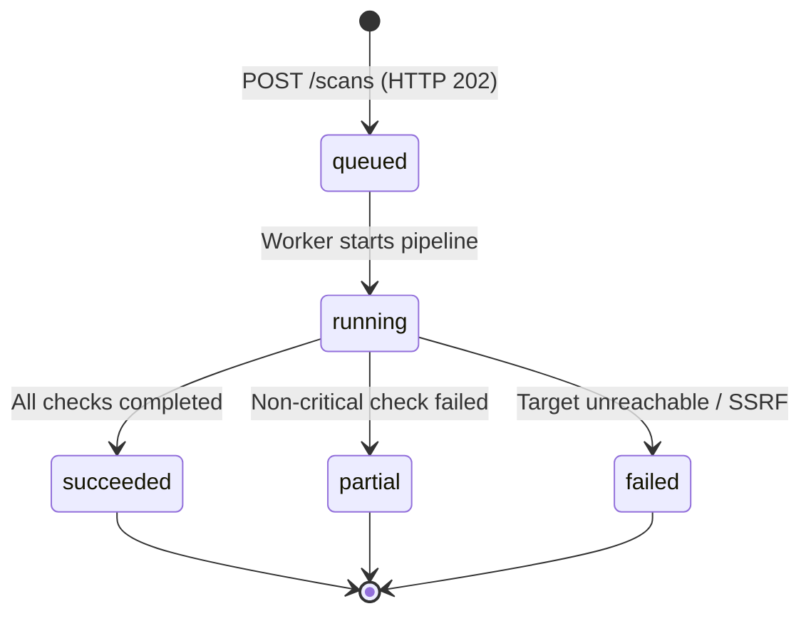

# TrustLens — Frontend Response & API Integration Requirements

**Document Version:** 1.0  
**Target Audience:** UI/UX Engineer, Frontend Engineering Team (React 19 / TypeScript)  
**Author:** Backend Architecture & Security Engineering Team  
**Scope:** Phases 1 through 5 (Application Foundation, Authentication, Scanning Infrastructure, Background Workers, and AI Intelligence Engine Integration)  
**Status:** Implemented, Tested, and Verified (41/41 Automated Tests Passing)

---

## 1. Architectural Overview & Responsibilities

TrustLens is a unified website security assessment platform delivering explainable security verdicts (`SAFE`, `SUSPICIOUS`, `MALICIOUS`, `INCONCLUSIVE`). 

### Three-Person Engineering Collaboration
1. **AI Engineer:** Develops the threat engine models, heuristic weights, and assessment logic (`shared/contracts/ai_contracts.py`).
2. **Backend Engineer (Provided):** Implements REST APIs, PostgreSQL ORM, Celery pipeline, strict SSRF/network validation, authentication, and integration bridges.
3. **UI/UX Engineer (You):** Builds the responsive React 19 / Vite / Tailwind CSS 4 frontend using Radix UI primitives, TanStack Query, and React Hook Form.

---

## 2. API Transport & Security Protocol

### 2.1 Base URLs
- **Local Development:** `http://localhost:8000/api/v1`
- **Docker Compose:** `http://api:8000/api/v1`
- **Health Check Root:** `http://localhost:8000/health`

### 2.2 Standard Request Headers
For every authenticated request, the frontend client must supply:
```http
Authorization: Bearer <access_token>
X-CSRF-Token: <csrf_token>
Content-Type: application/json
X-Request-ID: <client-generated-uuid-v4>
```
*Note: `X-Request-ID` is optional from the client. If omitted, the FastAPI backend generates a UUID v4 and returns it in the response header `X-Request-ID` and in error payloads.*

### 2.3 Token Lifecycle & Rotation
- **Access Token:** Short-lived JWT (15 minutes). Sent in `Authorization: Bearer <access_token>`.
- **Refresh Token:** Rotated 7-day token. Kept in memory or secure storage and sent via `POST /api/v1/auth/refresh`.
- **CSRF Token:** Sent upon login/registration in the response body (`tokens.csrf_token`). Must be held in auth memory state and passed via `X-CSRF-Token` on state-changing methods (`POST`, `PUT`, `PATCH`, `DELETE`).
- **Token Invalidation:** On HTTP 401 (`AUTHENTICATION_REQUIRED`), purge auth state and redirect to `/login?returnUrl=...`.

---

## 3. Centralized Error Envelope

All error responses from the backend follow this exact JSON contract. The frontend must parse errors using this structure rather than attempting to read raw Python stack traces.

### 3.1 Error Response JSON Schema
```json
{
  "error": {
    "code": "TARGET_NOT_PUBLIC",
    "message": "The target hostname or IP address resolves to a private, loopback, or non-public network address.",
    "request_id": "8f889988-51ec-46ce-bd5e-9907f9c8caea",
    "details": {
      "host": "localhost",
      "resolved_ips": ["127.0.0.1"]
    }
  }
}
```

### 3.2 Canonical Error Codes & UI Action Matrix

| Error Code | HTTP Status | Meaning | Recommended UI Treatment |
|---|---|---|---|
| `VALIDATION_ERROR` | 422 / 400 | Malformed schema or invalid field syntax | Highlight invalid inputs using inline form field errors. |
| `AUTHENTICATION_REQUIRED` | 401 | Missing, malformed, or expired access token | Clear session state and route to `/login`. |
| `FORBIDDEN` | 403 | Insufficient role or attempt to view another user's scan | Render full-page `Access Denied` panel. |
| `RESOURCE_NOT_FOUND` | 404 | Scan, finding, or user not found | Render `Not Found` empty state with return CTA. |
| `STATE_CONFLICT` | 409 | Duplicate resource conflict (e.g. email already exists) | Display inline collision notice on email field. |
| `RATE_LIMIT_EXCEEDED` | 429 | Sliding window rate limit exceeded | Toast warning with `Retry-After` seconds countdown. |
| `TARGET_NOT_PUBLIC` | 400 | SSRF Defense: loopback, private, or cloud metadata IP | Show security notice: *"Private, loopback, and internal addresses cannot be scanned."* |
| `UNSUPPORTED_URL_SCHEME` | 400 | Non-HTTP/HTTPS protocol (e.g. `ftp://`, `file://`) | Inline error: *"Only HTTP and HTTPS URLs are supported."* |
| `CREDENTIALS_IN_URL_REJECTED` | 400 | URL contains `user:pass@host` | Inline error: *"URLs containing credentials are not permitted."* |
| `PORT_NOT_ALLOWED` | 400 | Port other than 80 or 443 submitted | Inline error: *"Only standard web ports (80 and 443) are supported."* |
| `REDIRECT_LOOP_DETECTED` | 400 | Target entered an infinite HTTP redirect loop | Scan failure badge: *"Target has an infinite redirect loop."* |
| `INTERNAL_ERROR` | 500 | Unhandled server exception | Display generic `ErrorState` card with `request_id` for support. |

---

## 4. Endpoints & Response Payloads (Phases 1–5)

### 4.1 Health Check Probes

#### `GET /health`
Returns top-level platform health.
- **Status:** 200 OK (or 503 if critical dependencies are down)
```json
{
  "status": "healthy",
  "version": "1.0.0",
  "environment": "production",
  "timestamp": "2026-11-07T13:30:00Z"
}
```

#### `GET /health/database`
- **Status:** 200 OK / 503 Service Unavailable
```json
{
  "name": "database",
  "healthy": true,
  "latency_ms": 1.45,
  "message": "Database ping successful"
}
```

#### `GET /health/redis`
- **Status:** 200 OK / 503 Service Unavailable
```json
{
  "name": "redis",
  "healthy": true,
  "latency_ms": 0.82,
  "message": "Redis ping successful"
}
```

---

### 4.2 Authentication Endpoints (`/api/v1/auth`)

#### `POST /api/v1/auth/register`
Creates a new account and returns initial tokens.
- **Request:**
```json
{
  "email": "analyst@example.com",
  "password": "SecurePassword123!",
  "display_name": "Security Analyst"
}
```
- **Response (HTTP 201 Created):**
```json
{
  "user": {
    "id": "e96f947e-8556-427c-b633-fc480c51b7fe",
    "email": "analyst@example.com",
    "display_name": "Security Analyst",
    "role": "user",
    "is_active": true,
    "created_at": "2026-11-07T13:30:00Z"
  },
  "tokens": {
    "access_token": "eyJhbGciOiJIUzI1NiIsInR5cCI6IkpXVCJ9...",
    "refresh_token": "eyJhbGciOiJIUzI1NiIsInR5cCI6IkpXVCJ9...",
    "token_type": "bearer",
    "expires_in": 900,
    "csrf_token": "e2a149c4dd7c4d51b31d2e82f3c051ac"
  }
}
```

#### `POST /api/v1/auth/login`
- **Request:**
```json
{
  "email": "analyst@example.com",
  "password": "SecurePassword123!"
}
```
- **Response (HTTP 200 OK):** Identical payload to registration response above.

#### `POST /api/v1/auth/refresh`
Rotates the refresh token and issues a new access token.
- **Request:**
```json
{
  "refresh_token": "eyJhbGciOiJIUzI1NiIsInR5cCI6IkpXVCJ9..."
}
```
- **Response (HTTP 200 OK):**
```json
{
  "access_token": "eyJhbGciOiJIUzI1NiIsInR5cCI6IkpXVCJ9...",
  "refresh_token": "eyJhbGciOiJIUzI1NiIsInR5cCI6IkpXVCJ9...",
  "token_type": "bearer",
  "expires_in": 900,
  "csrf_token": "8d3840212fef403692df894a8f9f2571"
}
```

#### `POST /api/v1/auth/logout`
Revokes the refresh session.
- **Response (HTTP 200 OK):**
```json
{
  "success": true,
  "message": "Successfully logged out."
}
```

#### `GET /api/v1/auth/me` or `GET /api/v1/users/me`
Fetches the currently authenticated profile.
- **Response (HTTP 200 OK):**
```json
{
  "id": "e96f947e-8556-427c-b633-fc480c51b7fe",
  "email": "analyst@example.com",
  "display_name": "Security Analyst",
  "role": "user",
  "is_active": true,
  "created_at": "2026-11-07T13:30:00Z"
}
```

---

### 4.3 Website Scan & Assessment Endpoints (`/api/v1/scans`)

#### `POST /api/v1/scans` (Submit Target for Analysis)
- **Request:**
```json
{
  "url": "https://example.com/login",
  "treat_as_sensitive": false
}
```

- **Response A: Fresh Scan Queued (HTTP 202 Accepted)**
```json
{
  "scan": {
    "id": "c1f7b029-4556-41bf-bb44-ec853c8b4ad1",
    "original_url": "https://example.com/login",
    "canonical_url": "https://example.com/login",
    "host": "example.com",
    "scheme": "https",
    "is_sensitive": false,
    "status": "queued",
    "verdict": "INCONCLUSIVE",
    "risk_score": null,
    "scoring_version": "trustlens-1.0",
    "checks_completed": 0,
    "created_at": "2026-11-07T13:32:00Z",
    "started_at": null,
    "completed_at": null,
    "failure_code": null,
    "failure_message": null
  },
  "deduplicated": false
}
```

- **Response B: Duplicate Scan within 60 Seconds (HTTP 200 OK)**
When an identical URL was submitted by the same user within the last 60 seconds and is still `queued` or `running`:
```json
{
  "scan": {
    "id": "c1f7b029-4556-41bf-bb44-ec853c8b4ad1",
    "original_url": "https://example.com/login",
    "canonical_url": "https://example.com/login",
    "host": "example.com",
    "scheme": "https",
    "is_sensitive": false,
    "status": "running",
    "verdict": "INCONCLUSIVE",
    "risk_score": null,
    "scoring_version": "trustlens-1.0",
    "checks_completed": 2,
    "created_at": "2026-11-07T13:32:00Z",
    "started_at": "2026-11-07T13:32:01Z",
    "completed_at": null,
    "failure_code": null,
    "failure_message": null
  },
  "deduplicated": true
}
```
*Frontend Action:* When `deduplicated: true`, immediately route to `/scans/:scanId` without displaying any error.

---

#### `GET /api/v1/scans` (List User Scans)
Returns paginated history strictly scoped to the requesting user.
- **Query Parameters:**
  - `page` (default: 1)
  - `page_size` (default: 20, max: 100)
  - `status` (optional filter: `queued`, `running`, `succeeded`, `partial`, `failed`)
  - `verdict` (optional filter: `SAFE`, `SUSPICIOUS`, `MALICIOUS`, `INCONCLUSIVE`)
- **Response (HTTP 200 OK):**
```json
{
  "items": [
    {
      "id": "c1f7b029-4556-41bf-bb44-ec853c8b4ad1",
      "canonical_url": "https://example.com/login",
      "host": "example.com",
      "status": "succeeded",
      "verdict": "SAFE",
      "risk_score": 12,
      "created_at": "2026-11-07T13:32:00Z",
      "completed_at": "2026-11-07T13:32:04Z"
    }
  ],
  "total": 1,
  "page": 1,
  "page_size": 20,
  "pages": 1
}
```

---

#### `GET /api/v1/scans/{scan_id}` (Comprehensive Scan Report)
The primary endpoint powering the Report Page.
- **Response (HTTP 200 OK):**
```json
{
  "scan": {
    "id": "c1f7b029-4556-41bf-bb44-ec853c8b4ad1",
    "original_url": "https://example.com/login",
    "canonical_url": "https://example.com/login",
    "host": "example.com",
    "scheme": "https",
    "is_sensitive": false,
    "status": "succeeded",
    "verdict": "SAFE",
    "risk_score": 12,
    "scoring_version": "trustlens-1.0",
    "checks_completed": 4,
    "created_at": "2026-11-07T13:32:00Z",
    "started_at": "2026-11-07T13:32:01Z",
    "completed_at": "2026-11-07T13:32:04Z",
    "failure_code": null,
    "failure_message": null
  },
  "coverage": {
    "threat_intel": "complete",
    "web_security": "complete",
    "certificate": "complete",
    "community": "complete"
  },
  "provider_checks": [
    {
      "provider": "openphish",
      "result_status": "no_match",
      "matched": false,
      "checked_at": "2026-11-07T13:32:03Z",
      "details": {
        "feed_timestamp": "2026-11-07T10:00:00Z"
      }
    },
    {
      "provider": "urlhaus",
      "result_status": "no_match",
      "matched": false,
      "checked_at": "2026-11-07T13:32:03Z",
      "details": {
        "query_status": "ok"
      }
    }
  ],
  "redirects": [
    {
      "hop": 1,
      "source_url": "http://example.com/login",
      "destination_url": "https://example.com/login",
      "status_code": 301,
      "host": "example.com",
      "ip": "93.184.216.34",
      "tls_verified": true
    }
  ]
}
```

---

#### `GET /api/v1/scans/{scan_id}/findings` (Findings & Explanations)
Returns fine-grained heuristic findings that generated the risk score.
- **Response (HTTP 200 OK):**
```json
{
  "items": [
    {
      "code": "HSTS_MISSING",
      "title": "Strict-Transport-Security Header Missing",
      "description": "The web server does not advertise HSTS, leaving users vulnerable to SSL-stripping man-in-the-middle attacks.",
      "severity": "medium",
      "category": "web_security",
      "points": 10,
      "evidence": {
        "header_evaluated": "strict-transport-security",
        "value": null
      },
      "remediation": "Add 'Strict-Transport-Security: max-age=31536000; includeSubDomains' to HTTP response headers.",
      "source": "backend_scanner"
    },
    {
      "code": "CSP_MISSING",
      "title": "Content-Security-Policy Missing",
      "description": "The site does not define a Content Security Policy to restrict origin execution of scripts.",
      "severity": "low",
      "category": "web_security",
      "points": 5,
      "evidence": {
        "header_evaluated": "content-security-policy",
        "value": null
      },
      "remediation": "Configure a Content-Security-Policy header restricting script execution to approved domains.",
      "source": "backend_scanner"
    }
  ],
  "total": 2
}
```

---

#### `GET /api/v1/scans/{scan_id}/certificate` (X.509 Certificate Details)
Returns full parsed cryptographic parameters.
- **Response (HTTP 200 OK):**
```json
{
  "host": "example.com",
  "valid": true,
  "subject": "CN=example.com,O=Internet Corporation for Assigned Names and Numbers",
  "issuer": "CN=DigiCert Global G2 TLS RSA SHA256 2020 CA1,O=DigiCert Inc,C=US",
  "valid_from": "2026-01-15T00:00:00Z",
  "valid_to": "2027-01-15T23:59:59Z",
  "days_until_expiration": 69,
  "sans": ["example.com", "www.example.com"],
  "serial_number": "0a1b2c3d4e5f6a7b8c9d0e1f2a3b4c5d",
  "sha256_fingerprint": "a4b5c6d7e8f90123456789abcdef0123456789abcdef0123456789abcdef0123",
  "signature_algorithm": "sha256WithRSAEncryption",
  "key_algorithm": "RSA (2048 bit)",
  "chain_valid": true,
  "hostname_match": true,
  "reasons": []
}
```
*Note on Certificate State:* If TLS is absent (HTTP-only) or handshake failed:
`valid` is `false`, and `reasons` contains explanations such as `["HOSTNAME_MISMATCH"]`, `["CERTIFICATE_EXPIRED"]`, or `["PORT_443_CLOSED"]`.

---

#### `DELETE /api/v1/scans/{scan_id}` (Delete Scan)
Deletes the scan and cascades deletion of its redirects, findings, and certificate records.
- **Response:** HTTP 204 No Content

---

## 5. Polling & State Transition Rules

### 5.1 Scan State Machine



### 5.2 Polling Algorithm
When on `/scans/:scanId`:
1. If `scan.status` is `queued` or `running`:
   - Poll `GET /api/v1/scans/:scanId` every **2 seconds** for the first 30 seconds.
   - If scan is still active after 30 seconds, back off to every **5 seconds**.
2. **Terminal Stop Condition:** When `scan.status` is `succeeded`, `partial`, or `failed`, cancel the polling timer immediately.
3. **Visibility Optimization:** Pause polling when the document is hidden (`document.visibilityState === 'hidden'`) and resume immediately upon visibility.
4. **No Artificial Loading:** Do not display a fake progress percentage (e.g. "45% done"). Display active step labels using `ScanStatusStepper`: *Queued* -> *Inspecting Network & DNS* -> *Running Threat Intelligence* -> *Completed*.

---

## 6. Verdict Semantics & UI Copy Rules

The platform enforces 4 unambiguous verdicts. The UI must strictly follow these rules:

| Verdict | Meaning | Design Token | Mandatory Canonical Copy |
|---|---|---|---|
| `SAFE` | Bounded checks found no known threats or high-severity vulnerabilities. | `--color-safe` (`#15803D`) | *"No material risk was found by the checks performed. This is not a guarantee that the website is safe."* |
| `SUSPICIOUS` | Indicators requiring caution (e.g. self-signed TLS, unconfirmed reports, missing security controls). | `--color-suspicious` (`#B45309`) | *"Some signals require caution. Review the findings before sharing information."* |
| `MALICIOUS` | Direct match in threat feed (OpenPhish / URLhaus) or confirmed malicious report. | `--color-malicious` (`#B91C1C`) | *"This URL matched a trusted threat indicator or independently confirmed community intelligence. Do not visit or enter information."* |
| `INCONCLUSIVE` | DNS/HTTP lookup failed, worker timeout, or sensitive URL prevented full scan. | `--color-inconclusive` (`#475569`) | *"TrustLens could not collect enough reliable evidence. Do not interpret this result as safe."* |

### Critical Presentation Guardrails
- **Disclaimer Required:** `SAFE` must NEVER display copy claiming "100% Secure", "Verified Legitimate", or "Virus-Free".
- **Padlock Icon Forbidden:** Never render a green SSL padlock as a badge of safety. A valid TLS certificate only guarantees encryption in transit, not legitimacy.
- **Provider Status Integrity:** When `result_status` is `unavailable`, `not_configured`, or `stale_cache`, render an amber warning icon with: *"This source could not be checked. It is not a clean result."* Never render it as "Clean" or "Safe".
- **Sensitive URL Display:** If `is_sensitive` is `true`, show an informational notice: *"Sensitive URL scan mode: URLhaus external check was skipped to protect privacy. SAFE verdict is disabled."*

---

## 7. Ready-to-Use TypeScript Definitions (`api.ts`)

Frontend developers can copy and paste the following TypeScript declarations directly into `src/types/api.ts`:

```typescript
// ==========================================
// TrustLens API TypeScript Type Definitions
// ==========================================

export type ScanStatus = 'queued' | 'running' | 'succeeded' | 'partial' | 'failed';
export type ScanVerdict = 'SAFE' | 'SUSPICIOUS' | 'MALICIOUS' | 'INCONCLUSIVE';
export type FindingSeverity = 'info' | 'low' | 'medium' | 'high' | 'critical';
export type FindingCategory = 'threat_intel' | 'web_security' | 'certificate' | 'community';
export type LayerCoverageStatus = 'complete' | 'partial' | 'unavailable' | 'not_applicable';
export type ProviderResultStatus = 
  | 'match' 
  | 'no_match' 
  | 'unavailable' 
  | 'not_configured' 
  | 'skipped_sensitive_url' 
  | 'stale_cache';

// Error Envelope
export interface ApiErrorPayload {
  error: {
    code: string;
    message: string;
    request_id: string;
    details?: Record<string, unknown> | null;
  };
}

// User & Auth
export interface UserRecord {
  id: string;
  email: string;
  display_name: string;
  role: 'user' | 'admin' | 'moderator';
  is_active: boolean;
  created_at: string;
}

export interface AuthTokens {
  access_token: string;
  refresh_token: string;
  token_type: string;
  expires_in: number;
  csrf_token: string;
}

export interface AuthResponse {
  user: UserRecord;
  tokens: AuthTokens;
}

// Scan Submissions & Records
export interface ScanCreateRequest {
  url: string;
  treat_as_sensitive?: boolean;
}

export interface ScanRecord {
  id: string;
  original_url: string;
  canonical_url: string;
  host: string;
  scheme: string;
  is_sensitive: boolean;
  status: ScanStatus;
  verdict: ScanVerdict;
  risk_score: number | null;
  scoring_version: string;
  checks_completed: number;
  created_at: string;
  started_at: string | null;
  completed_at: string | null;
  failure_code: string | null;
  failure_message: string | null;
}

export interface ScanSubmitResponse {
  scan: ScanRecord;
  deduplicated: boolean;
}

export interface ScanSummaryItem {
  id: string;
  canonical_url: string;
  host: string;
  status: ScanStatus;
  verdict: ScanVerdict;
  risk_score: number | null;
  created_at: string;
  completed_at: string | null;
}

export interface LayerCoverage {
  threat_intel: LayerCoverageStatus;
  web_security: LayerCoverageStatus;
  certificate: LayerCoverageStatus;
  community: LayerCoverageStatus;
}

export interface ProviderCheckItem {
  provider: string;
  result_status: ProviderResultStatus;
  matched: boolean;
  checked_at: string;
  details: Record<string, unknown>;
}

export interface RedirectHopItem {
  hop: number;
  source_url: string;
  destination_url: string;
  status_code: number;
  host: string;
  ip: string;
  tls_verified: boolean;
}

export interface ScanDetailResponse {
  scan: ScanRecord;
  coverage: LayerCoverage;
  provider_checks: ProviderCheckItem[];
  redirects: RedirectHopItem[];
}

export interface FindingItem {
  code: string;
  title: string;
  description: string;
  severity: FindingSeverity;
  category: FindingCategory;
  points: number;
  evidence: Record<string, unknown>;
  remediation: string;
  source: string;
}

export interface CertificateDetails {
  host: string;
  valid: boolean;
  subject: string;
  issuer: string;
  valid_from: string | null;
  valid_to: string | null;
  days_until_expiration: number | null;
  sans: string[];
  serial_number: string | null;
  sha256_fingerprint: string | null;
  signature_algorithm: string | null;
  key_algorithm: string | null;
  chain_valid: boolean;
  hostname_match: boolean;
  reasons: string[];
}

// Paginated Container
export interface PaginatedResponse<T> {
  items: T[];
  total: number;
  page: number;
  page_size: number;
  pages: number;
}
```

---

## 8. Summary Checklist for UI/UX Engineer

- [x] **Backend Ready:** All Phase 1–5 APIs implemented with Async SQLAlchemy and FastAPI.
- [x] **Automated Tests:** 41/41 passing unit and integration tests.
- [x] **SSRF Defense:** Hardened against loopback, cloud metadata (169.254.169.254), carrier-grade NAT, and private IPs.
- [x] **Deduplication:** Automatic 60-second window avoids redundant scan charges and worker bottlenecks.
- [x] **AI Contract Guardrails:** Typed Pydantic and JSON schema contracts integrated without fabricating ML scores.

